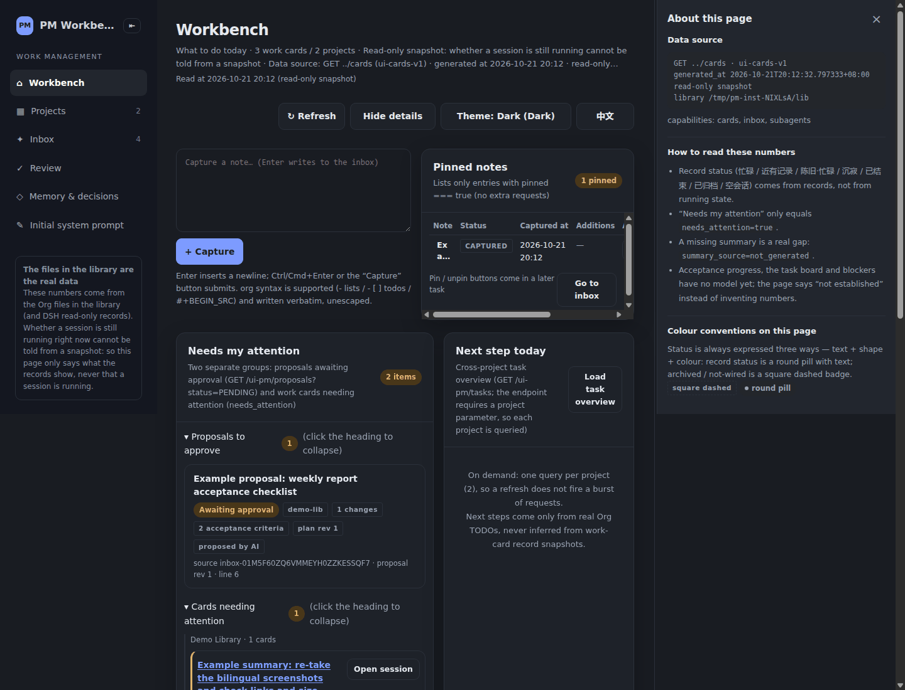

<h1 align="center">dsh-pm</h1>

<div align="center">

[English](README.md) · **简体中文**

</div>

<p align="center"><b>把 DSH 的工作区与会话状态，整理成以 Org 为唯一真源的「项目 / 任务 / 随手记 / 提案 / 记忆」工作库</b></p>

<p align="center"><b>会话会自动过期，Org 文件不会。</b></p>

<div align="center">

[使用教程](USAGE.zh-CN.md) · [界面截图](docs/screenshots.zh-CN.md) · [skill](skill/pm/SKILL.md) · [变更记录](CHANGELOG.md) · [MIT](LICENSE)

</div>

<p align="center">
  
  
  
  
</p>

它解决的问题：会话记录散在多个 DSH 数据根里 —— 会话**没有标签、也没有整理好的历史**，「做过什么」只能靠标题或手工笔记去找（标题还常常只是 "You are working in the …" 这样的半句话），做完的事很容易丢。
dsh-pm 只把会话当**只读输入**，整理成一张张「工作卡」；而「人真正要维护的东西」——任务、验收标准、证据、决策——留在你自己的 Org 文件里：可读、可 diff、可长期保存，不依赖数据库或云服务。

## 特性（Features）

- **以 Org 为唯一真源。** 项目 / 任务 / 随手记 / 提案 / 记忆全是 `.org` 文本：可读、可 diff、可长期保存，不依赖数据库或云服务。
- **会话只是只读输入。** 工作卡由 DSH 投影生成，工具永远不冒充「事实」；运行状态恒为 `unknown` —— 我们读到的只是 DSH 写下的**快照**，快照里没有「此刻是否还在跑」的信号，所以不猜。
- **可核对的验收标准 + 证据。** `pm task create --criterion` 建标准；`pm task evidence add --kind/--result` 挂证据（不知道就写 `info`，绝不猜 `pass`）；**`DONE` 只能由人写**。
- **AI 只能提案，不能批准。** `pm proposal create` 只写提案；人 `pm proposal approve` 才创建正式任务。
- **三条 skill 让 agent 会用**：`pm` / `pm-evidence` / `pm-planning` —— `pm skill install` 一条命令装进 DSH。
- **自带 Web 工作台**（原生 JS/CSS，不需要构建）：工作卡 / 收件箱 / 任务看板（拖拽 + 子任务 DAG）/ 提案 / 记忆 / 项目简报；**也可以只用 CLI + MCP**。
- **一条命令装插件**：`dsh plugin add github:SunrShine/dsh-pm`（指定 profile 时 `dsh plugin --profile <profile> add github:SunrShine/dsh-pm`）。

- 本 README 是**自足**的：读者只有本仓库也能装、能跑、能理解。
- 设计与验收的细节记录属于**内部资料，未随仓库发布**；正文里凡引用它们的地方，都写成「内部记录（未随仓库发布）」并给出命令与日期。
- 给 agent 的 skill（随仓库分发）：[skill/pm/SKILL.md](skill/pm/SKILL.md)；每份 skill 的细节放在相邻的 `references/` 里（按需加载，不塞进主文件）。

> 状态：**v0.3 系列**（最新发布 **v0.3.1**，2026-10-22）；仓库已**公开**：[github.com/SunrShine/dsh-pm](https://github.com/SunrShine/dsh-pm)。
> 未完成的东西一律放在文末[路线 / 未完成](#路线--未完成)，不写成已完成。

## 界面

截图来自**自建演示库（纯假数据）**（**深色模式**：`localStorage["pm-theme"]="dark"` + `prefers-color-scheme: dark`）：库里只有 `demo-app` / `demo-lib` 两个示例项目与「示例任务：…」这类条目，
**不含任何真实项目名、真实路径或真实会话 ID**（可复核：对页面文本 grep 真实 project key / 家目录路径 / `session-<uuid>` 均为 0 命中）。
复现方式：

```bash
pm init --root ~/dsh-pm-demo --no-git          # 建骨架（随后删掉按真实环境扫出来的项目目录）
printf 'library = "~/dsh-pm-demo"\n' > ~/dsh-pm-demo/pm.toml
pm project create demo-app --config ~/dsh-pm-demo/pm.toml --title "演示项目"
pm project create demo-lib --config ~/dsh-pm-demo/pm.toml --title "演示库"
# 其余示例数据用 pm task create/transition、pm capture、pm memory add、pm proposal create 生成；
# 起一次性实例时把这些 env 显式指向假库：DSH_UI_PM_PM_BIN=…/bin/pm  DSH_UI_PM_CONFIG=~/dsh-pm-demo/pm.toml
```

工作台装进 DSH 后，由 DSH 在 `/ui-pm/*` 下提供数据与路由；下面是代表图（工作台）：



**更多界面截图见 [docs/screenshots.zh-CN.md](docs/screenshots.zh-CN.md)**（7 张：侧栏入口 / 工作台 / 项目简报 / 任务看板 DAG / 收件箱 / 任务历史 / 待验收）。

工作台是一个自带的静态前端（`frontend_impl/`：原生 JS/CSS，不需要构建）。页面结构如下（文字描述）：

- **左侧栏**：项目树（库里已建目录的项目 ∪ 只在 DSH 里出现过的项目）与会话列表，可折叠；选中的项目决定中间区内容。
- **中间区**：工作台（工作卡 + 顶部「随手记」卡片 + 待批准提案横幅）／项目看板（5 列，可横向滚动、卡片可拖到状态列）／
  任务、待验收、记忆页；任务卡可展开看子任务与 DAG。
- **右栏**：详情面板，宽度可拖拽；收件箱详情含原文（只读）、补充、修订（记旧值）、历史、置顶；
  任务详情含验收标准勾选、执行配置与 handoff。
- **收件箱**：随手记列表 + 分流动作（归档/延期/合并/丢弃/存为笔记）；行上显示补充/修订计数与置顶状态。

界面怎么描述都替代不了真图（上面这些就是实拍）；**ASCII 架构图见下文[架构图](#架构图)**。

## 30 秒快速开始

**哪半能独立用**：`bin/pm`（CLI + MCP）与三条 skill（`skill/`）**不需要 DSH 宿主** —— 只想要「给 agent 一个自己的 org 记忆库」，到这一层就够了；
**插件半**（Web 工作台 / `/ui-pm/*` 路由 / `lib/`）需要 **DSH 宿主**（最低版本见下方 **「插件半的最低版本要求」**），`package.json` 的 `devDependencies` 里那些 `@deepseek-ai/dsh-*` 只在开发插件半时才需要。
**插件半的最低版本要求**：DSH ≥ **`0.2.1-alpha.1`**（本仓库随该版本开发与验证；更低版本未验证，可能无法加载）；**CLI 与三条 skill 不需要 DSH**。

按使用场景的完整教程见 **[USAGE.zh-CN.md](USAGE.zh-CN.md)**（30 秒跑起来 → 让 agent 会用 → 一天的工作流 → 和 DSH 一起用 → 多库/多实例 → 常见问题 → 命令速查）。

### A. Python 后端（CLI / MCP）

**当前仓库里不需要安装**：`bin/pm` 会把 `src/` 加进 `PYTHONPATH` 直接跑；**零第三方依赖**（只用 Python 标准库）。

```sh
git clone https://github.com/SunrShine/dsh-pm && cd dsh-pm

./bin/pm --help                                            # 看全部命令
./bin/pm scan                                              # 只读：DSH 各项目 / 工作卡现状
./bin/pm init   --root ~/my-work-memory --project demo01   # 搭库骨架（人工文件只在缺失时创建）
./bin/pm project list --json                               # 看库里的项目（已建目录的 ∪ 只在 DSH 里出现过的）
./bin/pm mcp                                               # 以 MCP server（stdio）运行，供 DSH 调用
./bin/test                                                 # 跑测试（见「开发与验证」）
```

也可以用 `pipx` 从 GitHub 装（**PyPI 尚未发布，计划中**）：

```sh
pipx install git+https://github.com/SunrShine/dsh-pm
```

`scan` / `ui-cards` 读的是你本机的 DSH 数据根（默认 `~/.dsh`，可用 `--instance` / `--dsh-home` 指定）；
写命令默认只认「显式 `--config`」指向的库，否则要求 `--yes`，防止误写真实库（见[诚实契约](#诚实契约)第 7 条）。

**配置查找顺序**（先找到先用）：`--config` > `DSH_UI_PM_CONFIG` > `PM_CONFIG` > 当前目录 `./pm.toml` >
`~/.dsh-pm/pm.toml` > 内置默认。
一个都找不到**也不会失败**：用内置默认值自动发现数据根（`pm scan` 会如实显示「无数据根」）。

### B. 作为 DSH 插件（Web 工作台）

安装走 **GitHub**（包名 `dsh-pm`）：

```sh
dsh plugin add github:SunrShine/dsh-pm
# 需要指定 profile 时：
# dsh plugin --profile <profile> add github:SunrShine/dsh-pm
```

> ⚠️ **npm 上的同名包 `dsh-pm` 不是本项目**（是他人占用的名字）。
> 因此**不要**用裸 `dsh plugin add dsh-pm` —— 那会装到别人的包上。本项目只提供 GitHub 安装路径。

**打开工作台要注意两点**（我们在截图时踩过，都跟 dsh-pm 无关）：

1. **必须用带 token 的 URL 打开。** 启动 DSH 时会打印一行
   ```text
   dsh web: http://127.0.0.1:<port>/?token=<token>
   ```
   默认会用浏览器直接打开它 —— 用这个地址就行。如果浏览器没自动打开（SSH / 无头 / 加了 `--no-open`），
   从日志里把那一行取出来：

   ```sh
   dsh web --no-open > /tmp/dsh-web.log 2>&1 &     # 或者用你平时的启动方式，只要日志留着
   grep -o "http://127.0.0.1:[0-9]*/?token=[^ ]*" /tmp/dsh-web.log | tail -1
   ```

   直接开不带 token 的 `http://127.0.0.1:<port>/` 会被拒：
   `dsh web authentication required; reopen the URL printed by dsh web.`（HTTP 401）。
   token 是每次启动新生成的，换一次启动就要重新取。

2. **如果这个实例还没配过模型 key，首次打开会弹出 DSH 自己的模型配置模态框**（标题 「Add an API key to get started」，
   中文界面是**「添加一个 API Key 开始使用」**）。它是让你填模型 API key 的，**跟 dsh-pm 无关**；
   点 **「Configure later」 /「稍后配置」** 关掉，就能看到工作台了。

- 兼容性：**不在包里写 `@deepseek-ai/dsh*` 的版本依赖**（也就是不做 peer 版本约束，避免被 DSH 的兼容检查挡住），随 **DSH `0.2.1-alpha.x`** 验证（实测 `0.2.1-alpha.1`）。
- 装好之后的行为细节（路由前缀 `/ui-pm/*`、前端随包发布、可用 `DSH_UI_PM_APP_DIR` 换目录）见源码；
  端到端安装复验还在进行，见[路线 / 未完成](#路线--未完成)。

## 核心概念

| 概念 | 是什么 | 落在哪 | 状态机 / 规则 |
|---|---|---|---|
| **项目** | 一个可由多个 DSH 工作区组成的单元 | `projects/proj-<key>/project.org`（人工） | 身份看 `:ID:`；简报六段：目标 / 范围 / 非目标 / 验收标准 / 里程碑 / 风险 |
| **任务** | 要做的具体事，带验收标准 | `projects/proj-<key>/tasks.org` | `TODO → NEXT → DOING → REVIEW → DONE`；`DONE` **只能由人写**，AI 只能到 `REVIEW` |
| **随手记（inbox）** | 一句话先记下来，之后再分流 | `inbox-human-<周期>.org` / `inbox-ai-<周期>.org`（人工按周 / AI 按月）；`inbox.org` 是生成视图 | `CAPTURED → TRIAGE → TASK_PROPOSED → TASK_CREATED`；归档/延期/合并/丢弃/存为笔记；**归档=时间轮转，不搬文件**（状态留在条目所在的周期文件里）；**原文只读**，补充是追加、修订记旧值 |
| **提案（proposal）** | AI 的计划，等人批准 | `proposals.org` | `PENDING → APPROVED / REJECTED`；**未批准的提案绝不创建正式任务** |
| **记忆（memory）** | 事实 / 决策 / 坑，可被 AI 当上下文 | `memory/{facts,decisions,gotchas}.org` + `memory-candidates.org` | `CANDIDATE → VERIFIED`（**只有人**能 verify）→ `DEPRECATED`（保留历史） |
| **工作卡（card）** | 一次 DSH 会话的只读写照 | 不落盘（`pm scan` / `ui-cards` 的输出） | 只说明缓存里记了什么，不代表正在跑（见[诚实契约](#诚实契约)） |

> **记忆是扁平的（2026-10-18 定为决定）。** 记忆之间只按**状态**（`CANDIDATE → VERIFIED → DEPRECATED`）
> 与**类型**（事实 / 决策 / 坑）区分，全部由人手工维护；`L1/L2/L3` 分层字段是**保留能力** ——
> 代码里有、界面不显示、日常不用（见 [`内部记录（未随仓库发布）)）。
> 所以：别把它当死代码删掉，也别在没有新决定的情况下把它接进界面或注入链路。


> **收件箱按来源分文件、按时间轮转（2026-10-22）。** 真源是 `inbox-human-<周期>.org`（人工写入，默认**按周**，如 `inbox-human-2026-W43.org`）
> 与 `inbox-ai-<周期>.org`（AI / MCP 写入，默认**按月**，如 `inbox-ai-2026-10.org`）。
> `inbox.org` 是**自动生成的汇总视图（只读）**：当前人工 + AI 文件内联，历史周期只列链接；
> `pm inbox render` 生成它，`pm inbox render --check` 校验它（过期则 exit 1）。
> **归档=时间轮转，不搬文件**：处理完的条目把状态（`ARCHIVED` / `TASK_CREATED` / …）留在它被写入的那个周期文件里，
> 所以「第 43 周发生了什么」仍然在 `inbox-human-2026-W43.org` 里。
> 旧库继续用单文件 `inbox.org`；`pm inbox migrate`（默认 `--dry-run`，加 `--write` 会先备份旧文件）按来源与周期拆分它。
> 轮转粒度是 `pm.toml` 的 `[inbox] human_mode` / `ai_mode`：代码默认 `single`（旧库原样可用），本机验证用的真实库配的是 `weekly` / `monthly`。
> 拆分不动审计与 CAS：条目仍按 `:ID:` 寻址，写入落在**当前装着它的那个文件**里。

所有**写入**都走同一条路（`entities.apply_change`）：先核对版本号（CAS，避免覆盖别人的修改）、
整文件原子替换、在条目里记一条审计、支持重复提交时只写一次；版本对不上就报 `exit 3`，一个字节都不落。

### 同时用多个 DSH 实例时的项目共享统计（legacy）

> **这是 legacy 功能**，为「同一台机器上同时开多个 DSH 实例」的用法保留（比如稳定版和预览版各装一份）。
> 只用一个 DSH 的话，这一节可以直接跳过。

多个 DSH 实例的数据是各管各的：每个实例有自己的工作区列表，也有自己的会话编号，
同一个编号在不同实例里可能指两件不同的事。所以 dsh-pm 用「实例 id + 会话编号」两个值合起来认一个会话
（配置里 `[[instance]]` 的 `id` 就是实例 id）。这样，多个实例里的会话能一起算进同一个项目，
又不会互相认错。

```toml
[[instance]]
id   = "default"    # 实例 id：要和会话编号一起，才能唯一确定一个会话
path = "~/.dsh"
role = "work"       # 只是用途标注（work=常用、explore=探索），目前不影响统计结果

[[instance]]
id   = "preview"    # 例如另一个 DSH 版本（或预览版）的数据目录
path = "~/.dsh-preview"
role = "explore"
```

- `pm scan --instance preview`：只看这一个实例，不混进别的实例的会话。
- `pm skill install`：默认装**全部**随工具分发的 skill，且只装到**当前正在运行的那个实例**——
  skill 是每个实例各自读取的，装到别的实例，这次会话看不到；要装到全部已配置实例，加 `--all-instances`。
  只要一条用 `--skill <名字>`；先看有哪些用 `pm skill path`（逐行列出名字与源目录）。重复执行**幂等**（已装过的原样保留，不重复动）。

## 命令与接口

### CLI（实测 `./bin/pm --help`，2026-10-23）

顶层 20 个命令：`scan`、`ui-cards`、`api`、`init`、`render`、`summary`、`log`、`capture`、
`inbox`、`task`、`proposal`、`memory`、`project`、`workspace`、`index`、`recall`、`hook`、`prompt`、`mcp`、`skill`。

| 命令 | 常用子命令 | 说明 |
|---|---|---|
| `pm scan` | `--all --limit 0`、`--instance`、`--json` | 只读读取 DSH：卡片 / 待办 / 缓存记录的新旧程度 |
| `pm ui-cards` | `--project`、`--limit`、`--dsh-home` | 给插件用的固定 JSON 格式（`schemaVersion=ui-cards-v1`） |
| `pm api` | `--query` | 统一 envelope（pm-api-v2）读入口 |
| `pm init` / `pm render` | `--root`、`--write`、`--dry-run` | 建库骨架 / 生成 `generated/**`（默认干跑） |
| `pm summary` | `queue`、`set` | 工作卡摘要（人工摘要优先，AI 不覆盖） |
| `pm log` | `--session`、`--project --missing` | 读会话日志提炼材料（只打印） |
| `pm capture` | `--project`、`--json`、`--dry-run` | 追加一条随手记；**按来源路由**：CLI（人工）→ `inbox-human-<周期>.org`，MCP/AI → `inbox-ai-<周期>.org` |
| `pm inbox files` | `--json` | 列出收件箱真源文件（人工 / AI 轮转文件；库没迁移时还会有旧单文件 `inbox.org`） |
| `pm inbox render` | `--check`、`--json` | 生成只读的 `inbox.org` 汇总视图；`--check` 只校验（过期 → exit 1，不写） |
| `pm inbox migrate` | `--write`、`--json` | 把旧单文件 `inbox.org` 按来源/周期拆开（**默认 dry-run**；`--write` 先备份旧文件，再重生成视图） |
| `pm inbox`（分流） | `list`（`--status`、`--origin human\|ai`） `/ archive/snooze/merge/note/dismiss/set-status/annotate/edit/history/pin/unpin` | 收件箱：分流 + 追加补充 + 显式修订（记旧值）+ 历史 + 置顶；每个动作都按 `:ID:` 寻址，写入落在当前装着它的那个文件 |
| `pm index` / `pm recall` | `--rebuild`、`--dry-run` / `--query`、`--scope`、`--type`、`--limit` | 记忆内容索引（派生物 `<库>/.local/index.sqlite`）/ 按默认口径检索（只含 VERIFIED） |
| `pm hook` / `pm prompt` | `session-start`、`recall`、`install` / `get`、`list`、`set`、`exports` | DSH hooks 记忆注入（只读、有预算、可一键关）/ 每项目初始提示词数据（CAS + 审计） |
| `pm task` | `list/show/create/transition/check/evidence/criteria/init-ids/dag/import-team/execution-config/link-session/unlink-session/handoff` | 任务、验收标准勾选与稳定编号、验收证据、DAG、AI 执行配置与 handoff（**不派发**） |
| `pm proposal` | `list/show/create/approve/reject/revise` | 提案：批准才建任务；修订保留 ID 并重挂源 revision |
| `pm memory` | `candidates/list/context/add/verify/deprecate/discard` —— 另有**保留**的分层命令 `scene/extract/condense/distill/stale` | 候选 → 人工确认 → 上下文包（只含 VERIFIED）；保留的那五条属 L1–L3 分层能力（当前不在界面与注入链路上用，见下文「记忆是扁平的」） |
| `pm project` | `list/create/context/brief get/brief set` | 项目统一列表、按骨架建目录、项目简报（读 / 显式改写一段） |
| `pm workspace` | `list/context` | 某项目的工作区；某工作区的记忆 + 会话（观察值） |
| `pm mcp` / `pm skill` | `path`、`install`（`--skill NAME`、`--all`、`--all-instances`） | MCP 服务（stdio 方式）/ 列出或安装随工具分发的 skill |

### HTTP 路由（插件宿主提供）

路由清单由插件的路由表（`domain-routes.ts`）定义，Web 前端实际调用的端点如下
（核对方式：`frontend_impl/app.js` 里的调用点。截至 2026-10-12：**34 条域路由 + `cards`/`capture`/`capabilities`，
另有 4 条 `UNSUPPORTED_ENDPOINTS`**；来源：内部前端评审记录，未随仓库发布）：

| 域 | 端点 |
|---|---|
| 卡片 / 宿主 | `GET /ui-pm/cards`、`GET /ui-pm/capabilities`、`GET /ui-pm/events`、`POST /ui-pm/capture` |
| 收件箱 | `GET /ui-pm/inbox`、`GET /ui-pm/inbox/:id`、`POST /ui-pm/inbox/:id/{archive,snooze,merge,note,dismiss,annotate,edit,pin,unpin}` |
| 任务 | `GET /ui-pm/tasks`、`GET /ui-pm/tasks/:id`、`GET\|POST /ui-pm/tasks/:id/execution-config`、`POST /ui-pm/tasks/:id/{link-session,unlink-session}`、`GET /ui-pm/tasks/:id/handoff` |
| 提案 | `GET /ui-pm/proposals`、`GET /ui-pm/proposals/:id`、`POST /ui-pm/proposals/:id/{approve,reject,revise}` |
| 项目 / 工作区 | `GET\|POST /ui-pm/projects`、`GET /ui-pm/projects/:id/context`、`GET\|POST /ui-pm/projects/:key/brief`、`GET /ui-pm/workspaces`、`GET /ui-pm/workspaces/context` |
| 记忆 | `GET /ui-pm/memory`、`POST /ui-pm/memory/:id/deprecate`、`POST /ui-pm/memory-candidates/:id/{verify,merge,discard}` |
| **未实现（明确拒绝）** | `POST /ui-pm/tasks/:id/dispatch`、`submit-review`、`accept`、`return`（4 条在 `UNSUPPORTED_ENDPOINTS`，带原因；见[路线](#路线--未完成)） |

写接口都要求带上你看到的版本号（`expectedRevision`，简报是 `expectedDigest`），
并返回固定的五个字段 `entityId / revision / source / observedAt / auditEventId`；
版本不一致 → `409`（CLI 里是 `exit 3`）。

### MCP 工具（`pm mcp`，stdio）

11 个工具（实测 `src/pm/mcp.py` 的 `TOOLS`，2026-10-23）：
`projects`、`cards`、`card`、`summary_queue`、`session_log`、`set_summary`、`capture`、
`pm_recall`、`task_add`、`proposal_draft`、`render`。

- `task_add` 只能建 `TODO`/`NEXT`：写 `DONE`/`CANCELLED` 会被明确拒绝（`DONE_REQUIRES_HUMAN`）。
- `proposal_draft` **只创建提案，绝不创建正式任务**（工具描述里写明）。
- `capture` 同样返回那五个字段，并落一条审计；它以 MCP（`source=mcp`）身份运行，因此追加到 **AI** 收件箱文件（`inbox-ai-<周期>.org`），从不写人工文件。

## 诚实契约

这是本项目最花力气的地方：**宁可写「不知道」，也不编**。

1. **运行状态恒为 `unknown`**。读到的只是 DSH 写下的只读快照，其中没有「会话此刻是否还在跑」的实时信号；因此任何界面/字段都不得声称某个会话「正在跑」；`runtime_status` 永远输出 `unknown`。
2. **观察值 ≠ 运行状态**。卡片的 `observation` 只描述「缓存记录了什么、有多新」：`BUSY / STALE_BUSY / RECENT / IDLE / CLOSED / ARCHIVED / EMPTY`。
3. **`CLOSED` ≠ `DONE`**；缓存里 `goal.phase = complete` 只显示为「已结束」，不等于验收通过。
4. **缺数据就写缺失**：没有摘要写「未建立」，没有工作区写「未接入」，不拿空对象冒充正常状态；空库/空载荷是合法输出。
5. **`DONE` 只能由人写**。AI 提交只能进 `REVIEW`；`DONE` 是终态，入口层就会拒绝 AI（MCP 的 `task_add` 也一样）。
6. **未批准的提案不建任务**。`proposal create` 只写 `proposals.org`（并在源 inbox 上标 `TASK_PROPOSED`），`approve` 才创建正式任务并把 inbox 标 `TASK_CREATED`。
7. **写入门禁与只报不删**：未显式给出 `--config` 时，写命令必须带 `--yes`；`pm render` 默认干跑，`--write` 才落盘；`generated/` 下不再属于本次计划的文件标为 `orphan`，**只报不删**（数据源临时不可用时自动删除会毁掉重建能力）。**默认不输出对话正文**：来自 prompt 的文本要显式 `--show-prompt` 才打印。
8. **假绿防护**（防的不是功能，是「验证本身说谎」）：
   - `scripts/verify-dsh-plugin.sh` 在验收开始/结束对 `inbox.org`、`overrides.org`、`projects/**` 取「文件集合 + 每个文件 sha256」指纹，改动/新增/删除都会 FAIL；并用 `--self-test-human-guard` 在临时副本上证明这条防线**真的会 FAIL**。
     **已知缺口**：指纹里仍只写单文件 `inbox.org`，多文件拆分后人工真源 `inbox-human-*.org` **尚未**被它覆盖（见[路线](#路线--未完成)）；所以 PASS 不能读成「人工收件箱没被动过」。
   - harness 注入（给前端打桩）必须有硬断言的锚点，禁止静默 no-op；守卫本身带负例自测（源自一次真实假绿事故）。
   - 某个领域模块损坏（ImportError/SyntaxError）不得让整个 CLI 起不来，其余域照常注册。
9. **原文只读 + 追加式补充 + 显式修订**：随手记的捕获原文永不就地改写；补充追加在正文里（带 actor/时间/rev）；确需改写走 `pm inbox edit --reason`，**旧值逐字留在条目里**。
10. **项目简报的写入口只有一个**：`pm project brief set`，用**整文件 sha256 CAS**，只替换你指定的那一段，同一次原子写里补齐 `:LOGBOOK:` 审计与 `:PM_BRIEF_UPDATED:`；`--actor` 必填，任何自动流程/导入不得调用。

## 架构图

```
        DSH 数据根（~/.dsh*/storages: workspace.json + 会话缓存）
                     │  只读（不外传正文、不读凭据）
                     ▼
   src/pm/sources/ ──► scan.py（归组/过滤/排序）──► model.py（Agent/Project/Todo/Goal + 观察值）
                     │                                        │
                     │                                        ▼
                     │                              render/（console/table/org/写入计划）
                     │                                        │
                     │                                        ▼
                     │                        generated/** + 库根 index.org（由工具整体重写；内容不含当前时间）
                     │
                     ▼
   ┌──────────────────────── work-memory 库（Org 是唯一真源）────────────────────────┐
   │ inbox-human-*.org + inbox-ai-*.org（+ 生成的 inbox.org）│ projects/proj-*/{project,tasks,memory}.org │
   │ proposals.org │ memory/*.org │
   └────────────────────────────────────────┬───────────────────────────────────────┘
                                            │  entities.apply_change（版本核对 + 原子写 + 审计 + 防重复提交）
                                            ▼
        pm CLI（16 个顶层命令） ◄──────► pm MCP server（10 个工具，stdio）
                    │                              │
                    └───────► pm ui-cards（稳定 JSON）◄───────┘
                                     │
                                     ▼
             DSH 插件（宿主半 + 浏览器半；/ui-pm/* 路由 + capabilities）
                                     │
                                     ▼
                       frontend_impl/ 静态工作台（无构建、原生 JS/CSS）
```

## 目录说明

```
bin/pm                      免安装启动器（自带 PYTHONPATH）
bin/test                    测试入口（unittest，零第三方依赖）
config/pm.toml              数据根、库路径、合并规则、噪声过滤
src/pm/
  model.py                  Agent / Project / Todo / Goal + 观察值状态机
  scan.py                   归组、过滤、排序
  sources/                  ~/.dsh*/storages 只读读取层
  entities.py               所有写入的公共实现（版本核对 + 原子写 + 审计 + 防重复提交）
  inbox.py / inbox_ops.py   收件箱解析与动作（分流 / 补充 / 修订 / 置顶），跨所有收件箱文件
  inbox_files.py            收件箱文件布局：按来源/周期的命名、聚合读取、生成视图、迁移
  tasks.py                  任务模型（状态机 / 验收标准 / DAG / import-team）
  proposals.py              提案模型（create / approve / reject / revise）
  memory.py                 记忆候选 → VERIFIED → 上下文包
  projects.py               项目列表 / 建目录 / 简报（读 + 显式改一段）
  execution.py              执行配置 / 会话关联 / handoff（只描述准备，不派发）
  ui_cards.py               给插件用的 JSON 格式
  mcp.py                    MCP server（stdio，10 个工具）
  render/                   org / 表格 / console / 写入计划
  scaffold.py               人工文件模板
skill/pm/SKILL.md           给 agent 的 skill
frontend_impl/              Web 工作台（原生 JS/CSS，无构建步骤）
scripts/                    验收与验证脚本（verify-*.sh / *.py；只读，可反复跑）
tests/                      单元与集成测试 + 自建 DSH 夹具
```

> work-memory 库也**不随仓库分发**：用 `pm init --root <你的目录>` 自建（人工文件只在缺失时创建）。

> 内部的设计 / 约定 / 验收 / 备忘记录**不随公开仓库发布**，因此本 README 不引用它们。

## 开发与验证

### 单元 / 集成测试

```sh
./bin/test                     # 全部测试（unittest，标准库）
```

**截至 2026-10-14，本机实测**：`Ran 814 tests` → `OK`。（这个数字随提交变化。）

### 独立验收（插件 + 各模块的约定）

```sh
./scripts/verify-dsh-plugin.sh                 # 严格模式：只读、可反复跑，默认不需要浏览器、不起服务
./scripts/verify-dsh-plugin.sh --with-host     # 额外起一个隔离实例，验插件的服务端接口 /ui-pm/cards
./scripts/verify-dsh-plugin.sh --self-test-human-guard   # 在临时副本上证明「人类文件指纹」防线会 FAIL
./scripts/verify-dsh-plugin.sh --interim       # 装配未完成时：缺件记 SKIP
```

**截至 2026-10-14，本机实测（strict）**：默认 `PASS=314 FAIL=0 SKIP=0 WARN=12`。
这些是**会随修复变化**的时点数，不是永久结论：引用任何数字时请带上日期与自己复跑的结果。
唯一一条 WARN 是「需人工确认」项：`lib/client.js` 的 grep 只能证明代码被编译进去，不能证明浏览器里真的点击生效。

内部验收记录（**未随仓库发布**）曾记录：早期一轮 `PASS=61 FAIL=0 WARN=3`（带 host 为 63）、当时 `./bin/test` 510 条。
引用任何数字时请带上日期与自己复跑的结果。

### 需要真机浏览器的验证

以下脚本用 CDP（无头 Chrome）派发真实事件；环境里没有浏览器时不会执行到这一步：

| 脚本 | 验什么 |
|---|---|
| `scripts/verify_dag_cdp.mjs` | 项目任务 DAG 的真机 SVG 渲染 + 展开态懒加载 + 居中滚动 |
| `scripts/verify_frontend_finish.py` | 前端收尾验收（简报编辑 / 提案修改 / 批准后显示什么） |
| `scripts/verify_board_series.py` | 看板列合并、5 列渲染、子状态小标签 |
| `scripts/verify_inbox_cards.py` | 收件箱卡片（补充计数 / 置顶 / 点开详情） |

其余 `scripts/verify_*.py` 要么只读代码、要么在临时库上验证，不需要浏览器（脚本只读，临时文件写在 `mktemp -d`）。

### 贡献方式

- 先开 issue 说清要改什么；**测试必须全绿**，不许用假绿绕过（见诚实契约第 8 条）。
- 写人工文件必须走 `entities.apply_change`（CAS + 审计）；不要手写绕过。
- 新增 JSON 字段按「只增不改」处理，并同步 `schemaVersion` 与内部记录里的说明。

## 路线 / 未完成

**明确标为计划中/进行中，当前不可用**：

| 项 | 状态 | 说明 |
|---|---|---|
| 界面截图 | **已补（演示库）** | 截图来自自建演示库 `~/dsh-pm-demo`（纯假数据，无真实项目名/路径/会话 ID）；复现命令见[界面](#界面)，全部 7 张见 [docs/screenshots.zh-CN.md](docs/screenshots.zh-CN.md) |
| 验收脚本里一条静态检查的误判 | **修复中** | 门禁里 1 条 FAIL 是检查本身写得太死（锚点匹配），不是功能缺陷 |
| 人类文件指纹 vs. 多文件收件箱 | **计划中** | `scripts/verify-dsh-plugin.sh`（C15）仍只对 `inbox.org` 取指纹；人工收件箱真源已是 `inbox-human-*.org` / `inbox-ai-*.org`，指纹尚未覆盖 |
| DSH 派发（谁去执行任务；含防重复派发与失败重试） | **未实现** | `POST /ui-pm/tasks/:id/dispatch` 在 `UNSUPPORTED_ENDPOINTS`；执行配置只有「没准备好」（`NOT_READY`）/「可以交接」（`HANDOFF_READY`），不假装已派发 |
| 专用 `submit-review` / `accept` / `return` 命令 | **未实现** | 现用 `pm task transition` + `actor=human` 等价 |
| 任务变更历史（把 `:LOGBOOK:` 里记的流水读出来）+ 详情界面 | **已交付** | `pm task show --json` 返回 `history` / `historyCount` / `historyTruncated`，任务详情右栏按时间倒序渲染（缺失字段写「未记录」） |
| 任务证据（截图 / 链接）、验收标准项的固定编号 | **已交付** | `pm task evidence add/list`（kind / result，不知道就写 `info`）与 `pm task criteria init-ids`（给旧标准补 `c-xxxx`） |
| AI 自评 + 事件时间线聚合 | **计划中** | 仍只存在于内部设计 |
| 前端 JS 模块拆分（第二阶段）+ 测试不再依赖读源码文本 | **进行中** | 当前那条静态检查因此报 FAIL |
| 拖拽/滑动的第三方库替换 | **评估中** | 拖放与横向滚动为自研实现（已可用）；是否换库在评估 |
| 插件安装的端到端复验 | **进行中** | 安装走 GitHub（见上）；干净 profile 复验未做完 |
| `pipx` / PyPI 发布 | **计划中** | `pipx install git+https://github.com/SunrShine/dsh-pm` 是目标形态；PyPI 未发布 |
| `pm.el`（Emacs org-agenda / capture 入口） | **已有**（仓库根 `pm.el`） | 看板跳转、agenda 文件、`C-c a P` 与多文件感知的 org-capture 模板（写当前 `inbox-human-*.org` 并带 `:ID:`）；另有 `pm-capture-inbox` / `pm-inbox-render` / `pm-inbox-open-current`（见 `emacs/README.md`） |
| 贡献者协议、CI 工作流 | **待补** | 许可已定为 MIT（见下） |
| 双语 README | **已提供** | `README.md` 为英文主文档，中文见 `README.zh-CN.md`；两份由 `scripts/verify_doc_pairing.py` 成对校验（一侧改了另一侧没跟上会红） |
| 与其它 DSH 版本的兼容范围 | **TODO** | 目前只随 `0.2.1-alpha.x` 验证过 |

## 许可与第三方

- **许可：MIT** —— 见仓库根的 `LICENSE` 文件（随发布产物一并生成）。
- **第三方依赖**：Python 侧**零第三方依赖**（标准库）；前端为原生 JS/CSS，无 npm 依赖、无构建步骤；拖拽/滚动为自研实现。
- **数据**：只读接入 DSH 数据根；不读取、不外传会话正文，不读凭据，不代替 DSH 做命令审批。
  **本仓库不随附任何库或笔记数据**：work-memory 由你用 `pm init --root <你的目录>` 自建；
  README 里的库路径一律是占位（`<你的数据根>` / `~/my-work-memory`），文中也不展示具体数据。

## 与 DSH 的兼容性

**不在包里写 `@deepseek-ai/dsh*` 的版本依赖**（不做 peer 版本约束，避免被 DSH 的兼容检查挡住），**随 DSH `0.2.1-alpha.x` 验证**：
实测于 `0.2.1-alpha.1`（preview 数据根）、`session_projcache` version 7。
字段清单和已知坑都写进了 `tests/fixtures.py` 的测试数据里（含坏数据例子），可以直接对照。

