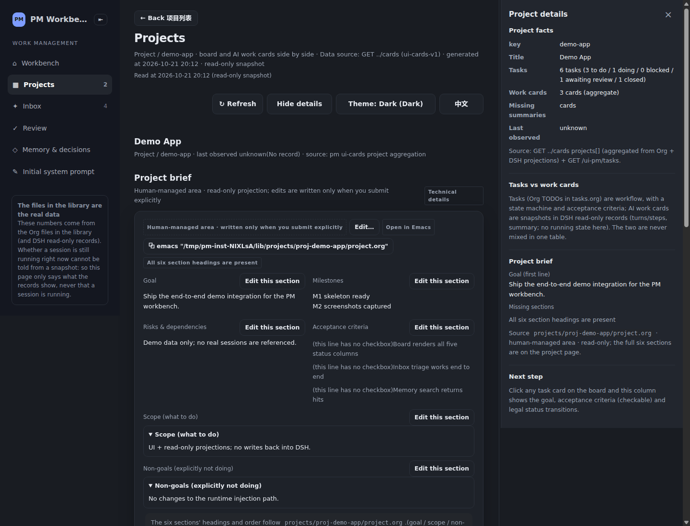
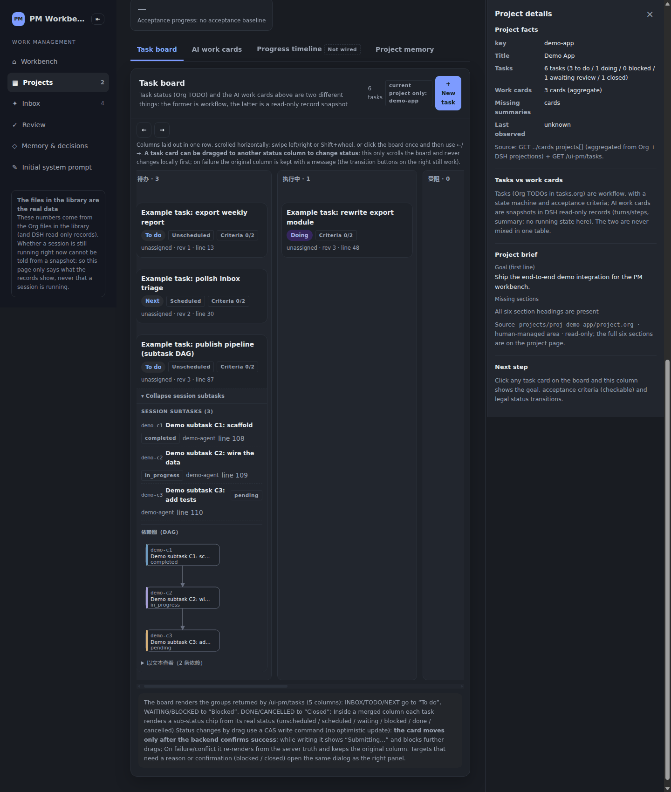
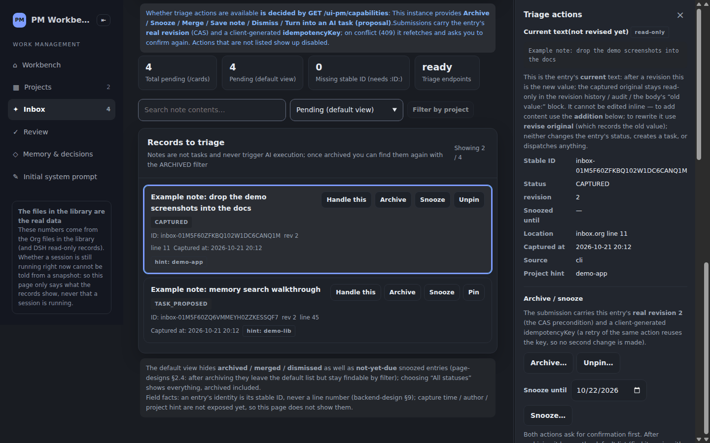
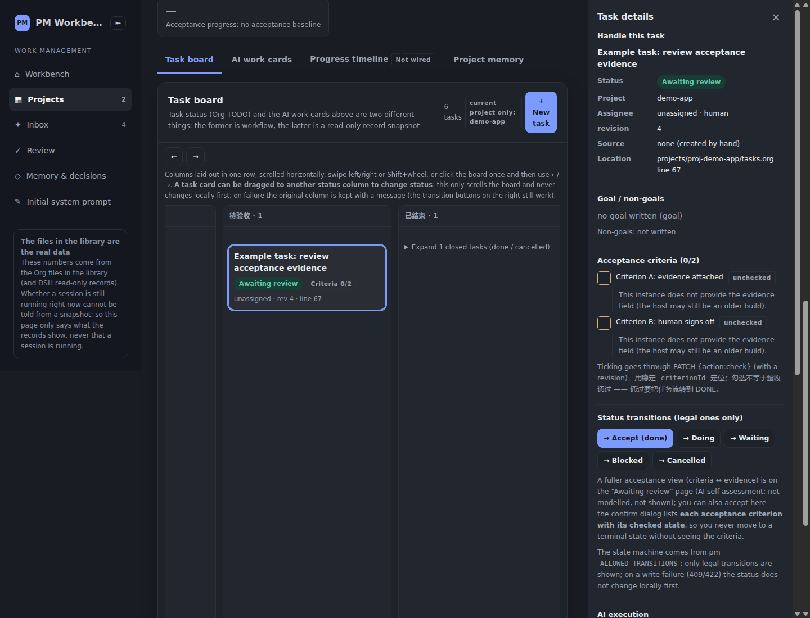
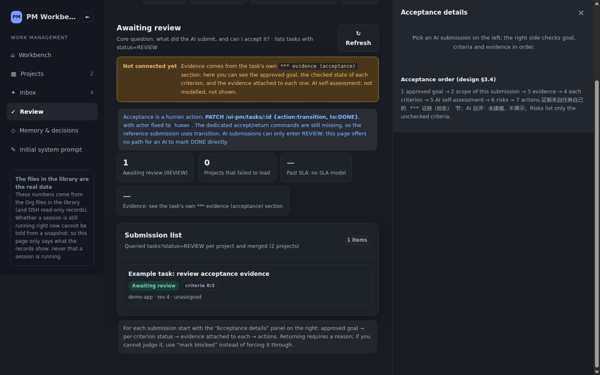

# Screenshots

English · [简体中文](screenshots.zh-CN.md)

All screenshots come from a **self-built demo library (pure fake data)** in **dark mode** (`localStorage["pm-theme"]="dark"` + `prefers-color-scheme: dark`).

The demo library only contains the two example projects `demo-app` / `demo-lib` and entries such as "Example task: …", and **no real project name, real path or real session ID** (verifiable: grepping the page text for a real project key / home path / `session-<uuid>` yields 0 hits).

For how to reproduce it see the [UI](../README.md#ui) section of the README.

The six in-app screenshots are **bilingual**: this page shows the **English UI** images (`<name>.png`), and the
[简体中文](screenshots.zh-CN.md) page shows the **Chinese UI** images (`<name>.zh-CN.png`). Both sets are captured from the
same fake-data demo library by one command: `node scripts/capture_screenshots_i18n.mjs both`
(it spins up an isolated throwaway instance, seeds `seed_demo_screens.sh`, captures each page in `?lang=en` / `?lang=zh`).
The sidebar-entry image is a DSH host-shell screenshot and is shared by both pages.

### Opening it from the DSH sidebar

Select "PM Workbench" in the sidebar and the workbench panel opens on the right.

### Workbench (quick notes + pinned)

A capture box sits at the top; below it are the pinned quick-note table and the pending-proposals banner.

### Project brief

The six-section project brief: goal / scope / non-goals / acceptance criteria / milestones / risks & dependencies.

### Task board (with subtask DAG)

A five-column status board; cards can be dragged between columns, and an expanded card draws the subtask DAG (the example has 3 nodes and 2 dependencies).

### Inbox

The quick-note list with triage actions (archive / snooze / merge / dismiss / save as note); rows show addendum/revision counts and pin state.

### Task detail (change history)

The change history in the task detail pane (newest first); missing fields read "not recorded" instead of being invented.

### Review

Tasks in REVIEW and the acceptance entry point — only a human writes DONE.

> All seven are above; the README's "UI" section inlines just one representative image (`workbench.png`).
