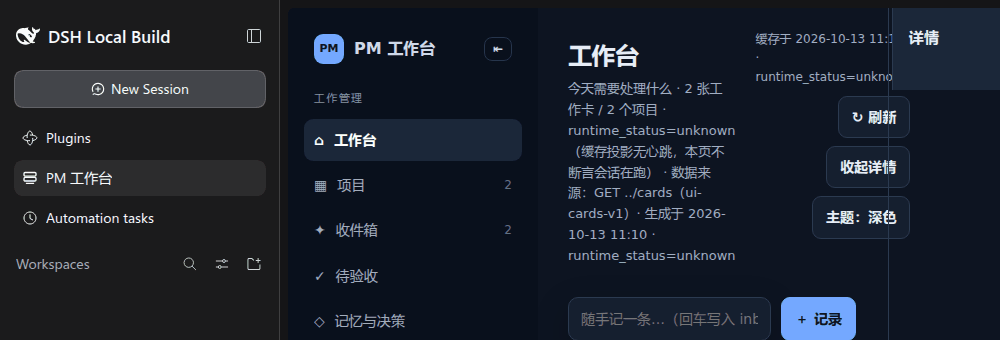
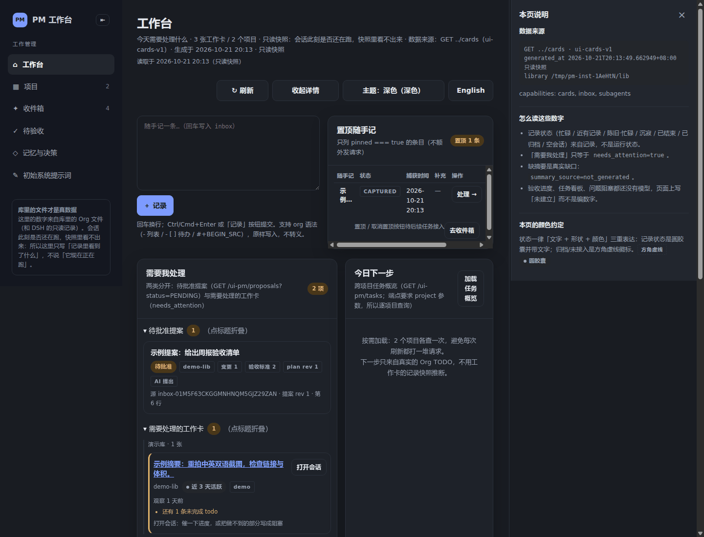
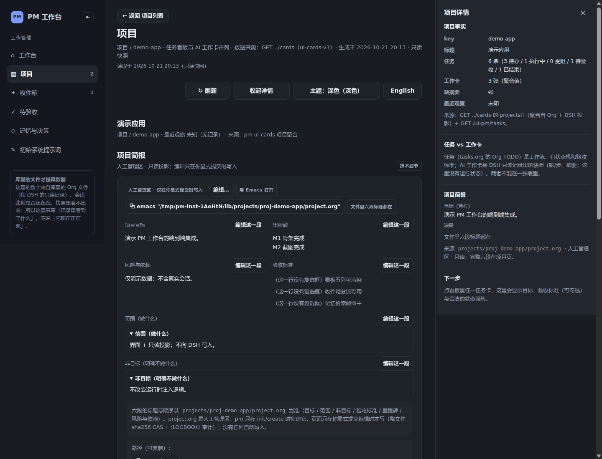
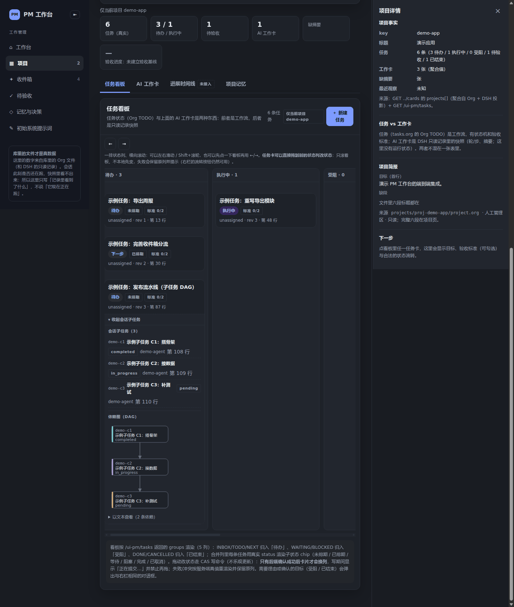
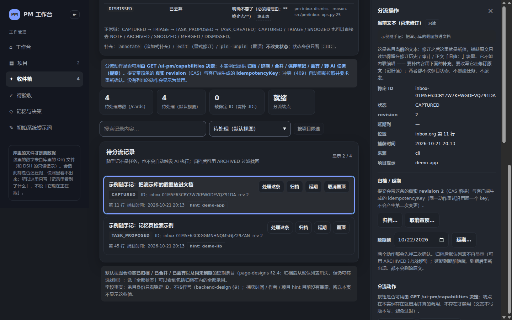
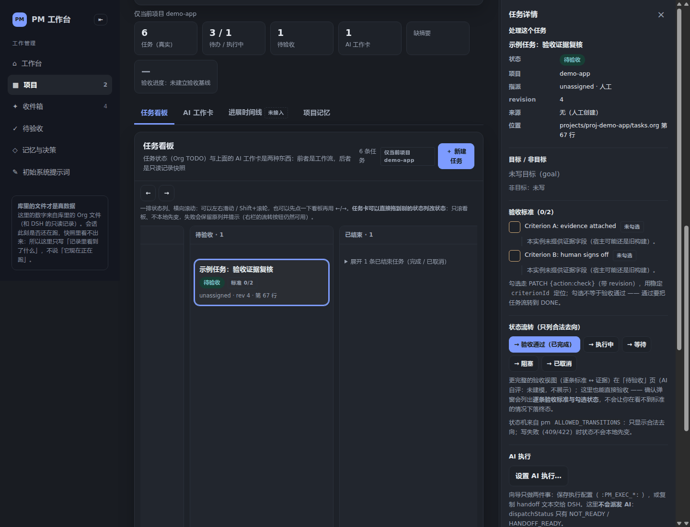

# 界面截图

[English](screenshots.md) · 简体中文

均为**自建演示库（纯假数据）**、**深色模式**（`localStorage["pm-theme"]="dark"` + `prefers-color-scheme: dark`）。
演示库里只有 `demo-app` / `demo-lib` 两个示例项目与「示例任务：…」这类条目，
**不含任何真实项目名、真实路径或真实会话 ID**（可复核：对页面文本 grep 真实 project key / 家目录路径 / `session-<uuid>` 均为 0 命中）。
复现方式见 README 的[界面](../README.zh-CN.md#界面)一节；截图沿用现有 7 张深色假数据图。

### 从 DSH 侧栏进入

选中侧栏里的「PM 工作台」，右侧打开工作台面板。

### 工作台（随手记 + 置顶）

顶部是快速记录输入；下方是置顶的随手记表格与待批准提案横幅。

### 项目简报

项目页的简报六段：目标 / 范围 / 非目标 / 验收标准 / 里程碑 / 风险与依赖。

### 任务看板（含子任务 DAG）

五列状态看板；卡片可拖到别的状态列，展开卡里画子任务 DAG（示例为 3 节点 2 条依赖）。

### 收件箱

随手记列表与分流动作（归档 / 延期 / 合并 / 丢弃 / 存为笔记），行上带补充 / 修订计数与置顶状态。

### 任务详情（变更历史）

任务详情右栏的变更历史（最新在上）；缺字段的地方写「未写入」，不编造。

### 待验收

REVIEW 状态的任务与验收入口——`DONE` 只能由人写。

> 全部 7 张见上；`README.zh-CN.md` 的「界面」一节只内联 1 张代表图（`workbench.png`）。
